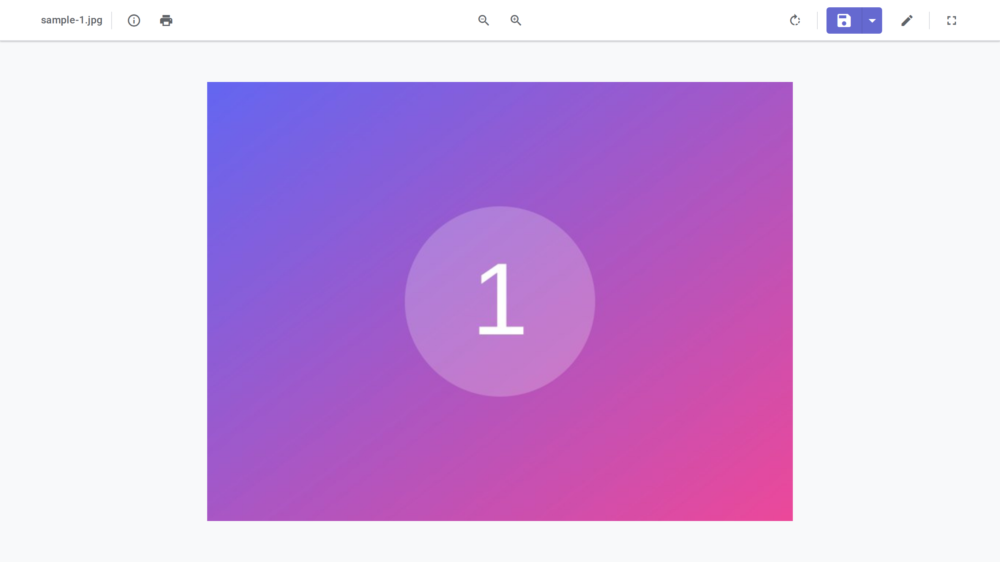
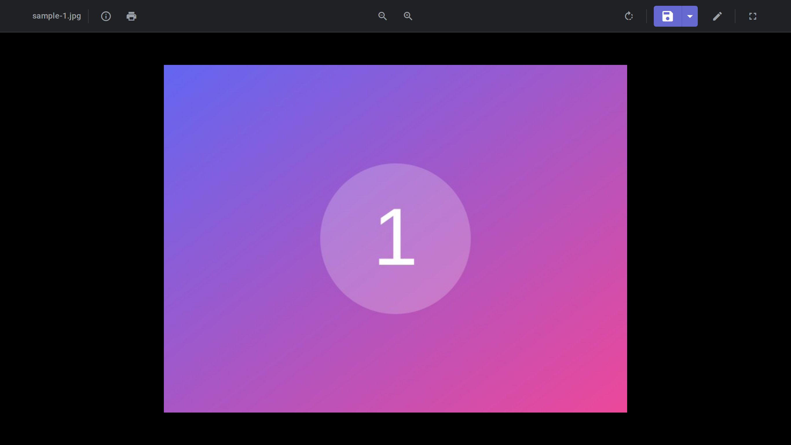

<div align="center">

<h1>JemaOS Gallery</h1>

### A fast, lightweight media gallery for images, video, audio and PDF

[](https://www.jematechnology.fr)
[](LICENSE)
[](#)
[](#)
[](README.md#-windows-msix)
[](#-contributing)

**Image viewer · video & audio players · PDF viewer · annotations · fullscreen · offline**

[Features](#-features) · [Screenshots](#-screenshots) · [Getting started](#-getting-started) · [Tech stack](#-tech-stack) · [License](#-license)

</div>



---

## ✨ Features

- 🖼️ **Image viewer** — zoom, rotate, pan, fullscreen
- 🎬 **Video player** with playback controls
- 🎵 **Audio player** for your tracks
- 📄 **PDF viewer** built in
- ✏️ **Annotation tools** — draw, highlight, add text on media
- 🖱️ **Drag & drop** and folder support
- 🌍 **English / French** UI
- 📶 **PWA** — installable and offline-capable
- 🪟 **Windows MSIX** packaging available

---

## 📸 Screenshots

| Light | Dark |
| :---: | :---: |
|  |  |

---

## 🚀 Getting started

This is a static web application — no bundler required.

```bash
git clone https://github.com/JemaOS/Galerie.git
cd Galerie
npm install
npm start          # serve the app (http://localhost:3000)
npm run dev        # live-reload development server
```

### Tests

```bash
npm test           # unit tests (Jest)
npm run test:e2e   # end-to-end tests (Playwright)
```

### Windows MSIX

The repo ships an `msix/` folder and build scripts to package Gallery as a Windows app. See the MSIX section of the original docs for the full flow.

---

## 🛠️ Tech stack

- **Vanilla HTML / CSS / JavaScript** (no framework)
- **Service Worker** + Web App Manifest for PWA/offline
- **PDF.js / libs** for document rendering
- **Jest** + **Playwright** for tests

---

## 📁 Project structure

```
scripts/   # app, viewers, annotations, i18n
styles/    # theming + responsive styles
libs/      # bundled libraries (PDF, etc.)
icons/     # app icons
msix/      # Windows packaging
```

---

## 🤝 Contributing

Contributions are welcome! Fork, branch, and open a pull request.

```bash
git checkout -b feat/my-feature
git commit -m "feat: my feature"
git push origin feat/my-feature
```

---

## 📄 License

Released under the **GNU AGPL-3.0** — see [LICENSE](LICENSE).

<div align="center">
Made with ❤️ by <a href="https://www.jematechnology.fr">Jema Technology</a>
</div>
